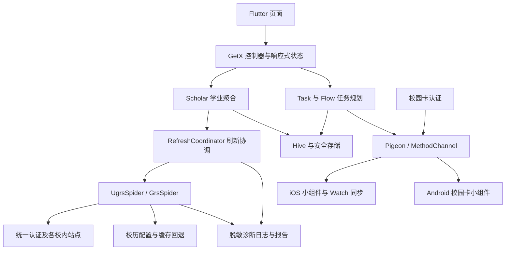

# Celechron 项目总结

> 2026-10-04 当前状态：产品仅面向 iOS、watchOS 与两端日程小组件，Android、macOS、Windows、Linux 工程已移出仓库。本地手动录入改造已完成至 S149，S150 真机升级/通知/同步验收仍待签名与设备。当前入口和工具链见 [README](README.md)，清理依据见 [清理报告](docs/PROJECT_CLEANUP.md)。下文为历史基线，不应据其旧网络功能或目录说明判断当前实现。

> 整理日期：2026-09-19
> 代码基线：`94e0ca6`；应用声明版本：`1.3.0+1`。
> 本文依据当前仓库源码、平台工程、测试和配置整理，不代表外部接口的实时可用性或各平台的发布验收结果。

> 当前改造仅面向 iOS、Apple Watch 及两端日程小组件，实施范围以 MANUAL_INPUT_PLAN.md 为准。下文保留基线版本的完整仓库事实；Android 和桌面工程描述不构成本轮修改或验收任务。iOS 主应用仍需要共享 Flutter 代码。

## 1. 项目定位

Celechron 是面向浙江大学学生的时间管理与学业信息客户端，使用 Flutter 构建主要界面，同时通过 Android、iOS 和 watchOS 原生代码提供校园卡、小组件及手表功能。

产品将课程、考试、作业和个人任务汇集到一个应用中：既能查询学业信息，也能根据截止日期、预计工作量和空闲时间自动安排任务。主界面包含「接下来」「日程」「任务」「学业」「设置」五个入口。

仓库主要包含客户端代码，没有发现独立后端服务实现。校内数据由客户端直接访问统一身份认证、教务、学在浙大、研究生院、素质拓展和校园卡系统获取；项目自己的远程服务提供校历配置和版本检查。

根目录 `LICENSE` 为 GNU GPL v3 许可证文本。部分文件另有第三方实现来源及许可说明，例如 `courses.dart` 对参考认证实现的说明。

## 2. 阅读范围与验证边界

本次覆盖了项目目录结构、Flutter 入口与业务模块、数据模型与持久化、网络服务、任务安排算法、后台任务、诊断系统、原生集成、测试目录及构建配置。重点深入阅读了启动、刷新、认证、任务规划和设备同步链路；图标、图片、生成代码和平台模板按用途与引用关系归类。

仓库中 `lib/` 有 **109 个 Dart 文件**，`test/` 有 **13 个 `*_test.dart` 文件**，此外还有测试夹具、独立诊断入口和 Swift 测试。

总结编写时（2026-09-19）仅新增本文档，没有修改业务代码；当时命令环境未发现 `flutter`、`dart`，因此未执行依赖安装、静态分析、自动化测试或构建，也没有使用真实账号访问校内服务。系统已于 2026-10-01 更换为 macOS，当前工具链状态见 [BASELINE.md](BASELINE.md) 的环境补充；本文其他源码描述仍是对应代码基线的静态调查结果。以下“已实现”表示源码中存在相关逻辑，不等同于真机验证通过。

## 3. 功能概览

| 模块 | 主要能力 | 核心位置 |
| --- | --- | --- |
| 接下来 | 汇总近期课程、考试、固定日程与规划任务；显示进行中的进度 | `lib/page/flow/` |
| 日程 | 按日期展示事件、切换日历与课表相关视图、创建和查看任务 | `lib/page/calendar/` |
| 任务 | 管理 DDL、固定日程、重复规则、完成进度、暂停和过期状态 | `lib/page/task/`、`lib/model/task.dart` |
| 自动规划 | 根据可用时间、课程占用、固定事项和截止日期分配工作时间 | `lib/algorithm/arrange.dart` |
| 学业 | 课表、课程详情、考试、成绩、学分、GPA、学在浙大作业 | `lib/page/scholar/` |
| 实践记点 | 第二、第三、第四课堂汇总和项目明细，美育、劳育通过状态 | `practice_score_page.dart`、`practice_score_item.dart` |
| 成绩计算 | 多种绩点制、首次成绩与最高成绩口径、自选课程与自定义加权 | `lib/utils/gpa_helper.dart`、`grade_detail/` |
| 搜索 | 按课程名称搜索已获取的各学期课程 | `lib/page/search/` |
| 校园卡 | 手机付款码、余额小组件、手表付款码及余额 | `ecard.dart`、`ecard_pay_page.dart`、各原生工程 |
| 日历导出 | 单学期或全部学期 `.ics` 导出、系统日历写入与清理 | `calendar_to_ical.dart`、`calendar_to_system.dart` |
| 后台提醒 | 成绩变化提醒、接近截止时间的学在浙大作业提醒 | `lib/worker/background_app_refresh.dart` |
| 设置与诊断 | 账号、主题、工作/休息时间、刷新模式、通知、日志查看与导出 | `lib/page/option/` |

需要区分两类“任务”：`Todo` 是从学在浙大获得的作业，`Task` 是本地管理和安排的 DDL 或固定日程。后台作业提醒读取 `Scholar.todos`，不能据此认为所有本地 `Task` 都已有系统通知。

## 4. 技术栈与目录结构

### 4.1 技术栈

| 层次 | 实现 |
| --- | --- |
| 主应用 | Dart、Flutter；以 Cupertino 风格为主，局部使用 Material 组件 |
| 状态与依赖 | GetX：`Get.put` / `Get.find` 注入，`Rx`、`Obx` 和 `ever` 更新 |
| 本地业务数据 | Hive、Hive Flutter、手写 TypeAdapter |
| 凭据保存 | `flutter_secure_storage`；Apple 原生侧使用 Keychain |
| 网络访问 | `dart:io` 的 `HttpClient`，手动处理 Cookie、重定向、CAS 和响应解析 |
| 后台及通知 | Celechron fork 的 `workmanager`、`flutter_local_notifications` |
| 平台通信 | Pigeon 生成的日程桥接代码、校园卡 MethodChannel |
| 日历及分享 | `device_calendar`、`timezone`、`share_plus`、`path_provider` |
| Android 扩展 | Kotlin、Compose、Glance 小组件 |
| Apple 扩展 | Swift、SwiftUI、WidgetKit、WatchConnectivity |

`pubspec.yaml` 声明 Dart SDK `>=3.0.0`，没有锁定具体 Flutter 版本。部分依赖固定了范围，但许多依赖没有版本约束，`workmanager` 跟随 Git `main`，`pigeon` 为 `any`。因此最低 SDK 声明不应被理解为当前全部源码和依赖都能在最早的 Dart 3 环境中构建。

### 4.2 目录导航

```text
Celechron/
├── lib/
│   ├── main.dart          启动、依赖注入、生命周期、深链与通知
│   ├── page/              五个主页面及其子页面、GetX 控制器
│   ├── model/             学业、任务、时间段模型及日历导出/同步
│   ├── http/              本科/研究生抓取编排、校历、重试和各站点服务
│   ├── database/          Hive 数据访问与适配器
│   ├── algorithm/         任务时间分配算法
│   ├── services/          刷新协调、诊断记录、脱敏、报告生成
│   ├── worker/            后台刷新、校园卡同步、版本检查
│   ├── pigeon/            日程 DTO 定义及生成的 Dart 通信代码
│   ├── design/            卡片、标题、刷新状态等共享组件
│   ├── utils/             时间、GPA、JSON、平台判断等辅助逻辑
│   └── debug/             学在浙大独立诊断入口
├── test/                  Flutter 单元测试与 Widget 测试
├── android/               Android 主应用与校园卡 Glance 小组件
├── ios/
│   ├── Runner/            iOS 启动与 Flutter/Watch 通信
│   ├── Shared/            Apple 端共享校园卡、日程及深链逻辑
│   ├── WidgetExtensions/  iPhone 日程与校园卡小组件
│   ├── CelechronWatch/    Apple Watch 应用、凭据存储与二维码编码
│   ├── WatchWidgetExtensions/ 手表小组件/表盘组件
│   └── CelechronWatchTests/    Swift 回归测试及二维码夹具
├── windows/、macos/、linux/    桌面平台工程
├── assets/                应用图片资源
└── .github/workflows/     格式与静态分析 CI
```

当前分层是务实的功能分层，并非严格隔离的领域架构：例如 `Scholar` 依赖数据库与页面控制器，日历模型文件也包含弹窗交互。这使功能开发直接，但会增加独立测试及后台复用的成本。

## 5. 架构与核心数据流



### 5.1 启动流程

1. 初始化 Flutter binding，安装校园卡原生回调，并声明前台活跃租约。
2. 初始化 Hive、安全存储和数据库适配器。
3. 从本地恢复 `Scholar`、任务列表、规划列表、设置和版本检查状态，并通过 GetX 注入。
4. 启动应用，先显示缓存内容。
5. 若恢复的用户具有登录标记，启动一次完整学业刷新，在刷新内部重建未持久化的网络会话。
6. 学业刷新完成后再更新校园卡凭据，减少两条认证链路在启动时相互干扰。

主应用监听生命周期：进入前台后定时续租，离开前台时停止租约。`celechron://ecardpaypage` 深链用于打开付款码页面。界面固定中文 locale 和 24 小时制，并支持跟随系统、浅色和深色主题。

### 5.2 学业模型

| 模型 | 职责 |
| --- | --- |
| `Scholar` | 用户学业聚合：学期、成绩、学分、GPA、作业、实践记点、更新时间 |
| `Semester` | 按学期组织课程、上课安排、考试、成绩，并结合校历展开日期 |
| `Course` | 课程信息及关联成绩、考试、上课安排 |
| `Session` | 周次、星期、节次等规则化上课信息 |
| `Exam` / `ExamDto` | 展示用考试模型及接口传输数据 |
| `Grade` | 成绩与不同绩点制转换所需信息 |
| `Todo` | 学在浙大的作业及截止时间 |
| `PracticeScoreItem` / 相关 Snapshot、Summary | 规范化实践项目、正式汇总、来源及过期状态 |
| `Task` | 本地 DDL、固定日程、重复规则与状态 |
| `Period` | 可具体定位到起止时间的课程、考试、日程或工作片段 |
| `Option` | 用户偏好与通知、规划、显示设置 |

`Session` 到 `Period` 的转换依赖校历中的节次时间、单双周、半学期和调休规则。因此，校历是任务规划、课程日期以及日历导出的基础数据。

### 5.3 本地存储

`DatabaseHelper` 管理设置、学业、任务、规划、原始响应缓存、版本检查、自选和加权 GPA 等 Hive box。部分名称保留历史命名，例如任务仍使用 `dbDeadline`，学业仍使用 `dbUser`；迁移时不能仅按当前类名重命名存储键。

账号密码另存安全存储，启动时再补回 `Scholar`。校园卡凭据和后台提醒需要的少量状态也使用安全存储。`ScholarAdapter` 将学业对象编码为 JSON 字符串，其他模型使用各自适配器。

没有看到 Hive box 配置加密参数，因此业务缓存不能等同于安全凭据存储。维护时应分别考虑业务数据、原始响应缓存、系统日历副本、小组件副本和凭据的生命周期。

## 6. 网络、认证与刷新机制

### 6.1 数据来源分工

| 文件/服务 | 作用 |
| --- | --- |
| `zjuam.dart` | 统一身份认证、SSO Cookie、CAS service ticket |
| `zdbk.dart` | 本科教务成绩、主修、课表、考试及实践相关接口 |
| `grs_new.dart` | 研究生院成绩、考试和课表接口 |
| `courses.dart` | 学在浙大认证与作业获取 |
| `sztz.dart` | 素质拓展认证、项目明细与正式记点汇总 |
| `ecard.dart` | 校园卡授权、账户选择和付款码 |
| `time_config_service.dart` | 学期校历配置与回退 |
| `github_service.dart` | GitHub 贡献者信息 |
| `worker/fuse.dart` | 应用版本检查；名称虽为 Fuse，实际不是通用请求熔断器 |

`appservice.dart` 明确标注旧服务已停用，是保留路径的空文件，不属于当前有效抓取链路。

`Scholar` 当前按学号是否以 `3` 开头区分本科与研究生；特定演示账号使用 `MockSpider`。这属于代码内业务规则，未来账号体系变化时需要重新验证。

### 6.2 刷新编排与降级

本科 `UgrsSpider` 将刷新拆成校历、课表、考试、成绩、主修、作业、实践七类任务；研究生 `GrsSpider` 使用对应编排，并包含本科生课和研究生课信息的处理。多个任务通过 Future 并行推进，但共同拼装学期的数据需要满足就绪条件后才向页面暴露。

主要策略包括：

- 同一客户端的并发认证共享执行中的登录；不同客户端不会随意共用同一 SSO 会话。
- 统一认证短时间复用内存会话，旧持久化 SSO Cookie 会被忽略和清理。
- 会话失效与网络瞬时失败分别处理，重登和重试次数受限；部分站点还控制请求串行或并发许可。
- 校验 HTTP 状态、响应类型、登录页、业务 JSON 和认证失败证据，避免把 HTTP 200 直接当作业务成功。
- 子模块失败时尽可能保留旧数据，不让一个来源异常覆盖全部结果。
- 页面可选择逐部分更新；默认关闭。模块进度提示与这一开关解耦。

很多错误仍通过字符串列表和关键字传递，`EverythingTuple` 也采用位置字段。这是阅读和维护时需要留意的隐式接口约定。

### 6.3 前后台协调

`RefreshCoordinator` 提供三层协调：

1. 同一 isolate 内，同账号同操作共享一个 Future。
2. 同账号不同操作排队执行，避免登录和刷新错误复用结果。
3. 跨 isolate 使用账号哈希命名的文件锁，结合心跳和遗留锁恢复。

前台活跃租约使后台任务在发现前台或账号忙锁时主动让行。文件锁默认过期时间为 30 秒、锁心跳为 5 秒；前台租约为 30 秒、前台续租间隔为 10 秒。账号明文不进入锁文件名。

这些机制降低了启动刷新、手动刷新和 Workmanager 同时认证造成的冲突，但仍需通过真实后台运行验证完整链路。

### 6.4 校历与实践记点

校历按“远程有效配置 → 相同学期缓存 → 推算配置”回退。推算配置仅用于保持课表可展示，不能视为官方校历；它不虚构节假日或调休，其他学期缓存也只作为节次时间模板。课表抓取还会探测未来学年，预期的未开放响应与一般故障分开处理。

实践记点将明细与汇总分开管理：明细来自 `getSqjl`；汇总优先使用实时 `getMyInfo`，其次使用账号隔离的有效汇总缓存，再回退到审核通过项目合计。二、三、四课堂的总记点只累加三个明确的记点字段，美育和劳育通过状态独立展示。部分失败时保留旧数据并记录来源、更新时间及过期标记。

## 7. 时间规划与成绩计算

### 7.1 规划算法

`FlowController.generateNewFlowList()` 收集进行中的 DDL，将允许工作时段展开到日期范围，再扣除课程、考试及会阻挡安排的固定日程，得到可分配时间段。

`findSolution()` 按截止时间排序任务，依次把剩余工作量放入空闲片段；对可中断任务按工作时长切分并插入休息。如果目标休息时长下无法安排，`getTimeAssignSet()` 在分钟范围内二分尝试更短休息，仍失败时返回无有效方案。

这是规则驱动的贪心时间分配，实现中没有优先级优化、通勤时间建模或全局最优证明。`isBreakable` 的实际行为也应结合跨空闲片段场景验证，不能仅根据字段名推断完整约束。

运行时每秒更新时钟与任务进度；较重的列表重建主要在数据变化或时间边界触发，并保留 60 秒自愈上限。进行中任务的工作量和规划更新时间约每 15 秒成对保存，用于重启后的时间补偿。

### 7.2 GPA

成绩处理包括五分制、四分制（4.3）、原始四分制和百分制。`Scholar` 的保研口径取分组中的首次成绩，出国口径取最高成绩；用户可通过课程号映射影响重修课程归组，也可选择课程或自定义权重。

自定义加权实现为：

```text
加权结果 = Σ(课程绩点 × 用户权重 × 原学分) / Σ(计入 GPA 的原学分)
```

权重不会改变分母中的学分。这是当前软件的计算规则，不能直接当作各学院规则的通用实现。

## 8. 平台与原生集成

| 平台 | 仓库中的能力与边界 |
| --- | --- |
| Android | Flutter 主应用、Workmanager、通知、校园卡 Glance 小组件；`minSdkVersion` 为 28 |
| iOS | Flutter 主应用、日程/校园卡 WidgetKit 小组件、后台刷新、通知、Watch 桥接；Runner 部署目标为 iOS 13，小组件为 iOS 14 |
| watchOS | SwiftUI 独立目标，日程、校园卡、表盘组件、Keychain 凭据；部署目标为 watchOS 10 |
| Windows / macOS / Linux | 存在 Flutter 工程；后台刷新和小组件判断主要限于移动端，其他插件能力需要分别验证 |
| Web | 没有 Web 工程，且核心代码依赖 `dart:io`，当前不能据此声称支持 Web |

这里的版本是工程配置值，不是依赖解析后的最低运行版本保证。

iOS 日程通过 Pigeon 将 DTO 传给原生，写入 App Group 并刷新 WidgetKit，同时通过 WatchConnectivity 同步至手表。校园卡则使用 `top.celechron.celechron/ecardWidget` MethodChannel；手表需要刷新凭据时，可以回调手机端 Dart 认证流程。

手表可使用本地校园卡凭据直接联网获取付款码，并区分认证失效与暂时网络故障。敏感凭据通过即时消息传输，代码避免将其放入持久化的 applicationContext/transferUserInfo；手表使用要求设备密码、仅限本机的 Keychain 项保存。普通日程和余额另走状态同步。

手表 `SimpleQRCode` 支持 Byte mode、纠错级别 M、固定 mask 0、Version 1–3，最大有效负载为 42 个 UTF-8 字节，超限失败而不是截断。

仓库虽然存在 `WidgetExtensionsLiveActivity.swift`，当前 WidgetBundle 只注册 `FlowWidget` 和 `ECardWidget`，也未看到启动 Activity 的调用链，因此不应把实时活动列为已完整接入的功能。

## 9. 后台提醒与诊断

后台刷新按 15 分钟周期提交给 Workmanager，并要求网络连接；实际运行由系统调度，不能承诺精确每 15 分钟执行。后台读取安全存储中的账号和通知偏好，比较 GPA 与已出分课程数量，并扫描接近截止的学在浙大作业，保存已通知 ID 避免重复提醒。

诊断系统使用 Zone 传播 `refreshId`，关联一次刷新中的模块请求、缓存使用、重试、重登、锁等待和耗时。日志在写入前对凭据、账号、业务字段及 URL 查询参数做脱敏，内存记录上限为 2000 行，导出文件保留数量上限为 10。

`diagnostic_report.dart` 将原始记录转换为易读报告，区分成功、失败、降级、共享调用和后台让行；页面支持切换原始日志、复制、导出及确认清空。排查网络问题时，优先沿报告中的刷新关联与模块结果定位。

## 10. 测试与开发流程

### 10.1 已有测试

| 方向 | 主要文件 |
| --- | --- |
| 认证与重定向 | `zjuam_grs_auth_test.dart`、`courses_auth_test.dart`、`sztz_auth_test.dart`、`ecard_auth_test.dart` |
| 刷新并发与状态 | `refresh_coordinator_test.dart`、`refresh_status_test.dart`、`refresh_result_dialog_test.dart` |
| 实践记点 | `practice_score_item_test.dart`、`practice_score_summary_test.dart`、`practice_score_page_test.dart` |
| 校历 | `calendar_config_parser_test.dart` |
| 日志与报告 | `diagnostic_report_test.dart`、`diagnostic_log_page_test.dart` |
| Apple 校园卡及二维码 | `ios/CelechronWatchTests/` |

Swift 测试包含独立二维码矩阵夹具、容量和 UTF-8 边界、Apple Vision 解码，以及校园卡认证和网络错误分类。其 README 明确保留了真实手表及实际支付终端的扫码验证要求。

当前测试目录没有专门针对任务安排、重复日程、GPA 算法、Hive 迁移和完整后台 isolate 刷新流程的测试文件。已有测试也不能代替真实校内系统和多设备端到端测试。

### 10.2 CI 现状

`.github/workflows/code_check.yml` 在面向 `main` 的 push 和 PR 上运行，使用 Ubuntu 与 Flutter stable，执行依赖安装、格式检查和静态分析。`flutter test` 步骤目前被注释；没有看到该工作流进行原生平台构建、Swift 测试或发布。

### 10.3 本地命令参考

在项目根目录、安装并配置好兼容的 Flutter SDK 后执行：

```sh
flutter pub get
flutter analyze --no-fatal-infos
flutter test
dart format --output=none --set-exit-if-changed .
flutter devices
flutter run -d <设备ID>
```

按当前源码定义重新生成日程桥接代码：

```sh
dart run pigeon --input lib/pigeon/prompt/flow_message_prompt.dart
```

独立学在浙大诊断入口：

```sh
flutter run -t lib/debug/courses_probe.dart
```

macOS 上运行 Swift 回归测试：

```sh
bash ios/CelechronWatchTests/run_tests.sh
```

以上为源码对应的开发入口，本次未执行。Android 还需匹配的 Android SDK/JDK；Gradle 当前使用 AGP 8.13.2、Kotlin 2.2.0，源码编译目标 Java 11 不代表 Gradle 运行时也应使用 JDK 11。Apple 构建需要 macOS、Xcode、CocoaPods，以及各 target 的签名、App Group 和 Keychain 配置。

版本以 `pubspec.yaml` 为主，Apple 附属目标通过 `ios/Configs/Version.xcconfig` 引用 Flutter 生成的版本；`lib/worker/fuse.dart` 仍维护一份独立版本常量，升级时应核对一致性。

## 11. 维护重点与待核查问题

以下是基于本文基线版本的历史维护建议，来自静态代码阅读；本次没有修改或验证这些问题。它们不代表手动输入改造的实施优先级，也不构成额外任务授权；当前改造按 MANUAL_INPUT_PLAN.md、MANUAL_INPUT_STEPS.md 及用户授权范围执行。

| 事项 | 代码证据与影响 | 后续处理方向 |
| --- | --- | --- |
| 构建可复现性 | 大量依赖未限制版本、Git 依赖跟随 `main`、`.gitignore` 忽略 `pubspec.lock`，CI 跟随 Flutter stable | 固定经验证的 SDK、依赖解析及 Git 提交，形成可复现构建基线 |
| CI 不执行测试 | 工作流中的 `flutter test` 被注释 | 将现有测试加入 CI，再按平台增加必要验证 |
| Android 发布签名 | `android/app/build.gradle` 的 release 使用 debug 签名 | 正式发布前配置独立 release 签名 |
| 后台对 UI 依赖 | 后台直接构造 `Scholar`，而 `_applyFetchResult()` 使用 `Get.find<OptionController>`；后台入口未见对应注册 | 验证真实 isolate 中的刷新；将课程映射等必要配置以数据形式传入 |
| Android 通道返回 | `MainActivity.kt` 的校园卡 handler 更新小组件后未调用 `result.success/error/notImplemented`，Dart 侧会等待 invokeMethod | 验证 Future 是否悬置，并为每个分支补全响应 |
| 跨午夜空闲时段 | `flow_controller.dart` 两处 `tmpr.add(Duration(days: 1))` 未接收返回值，而 DateTime 不可变 | 验证跨天允许时段并修复赋值，补充规划边界测试 |
| 空学期时间段 | `Scholar.thisSemester` 在多学期时直接读取 `semesters[1].periods.last` | 覆盖只有成绩、没有课表和考试的学期，检查空列表保护 |
| 字符串错误协议 | 刷新状态和保留旧值依赖“成绩”“课表”“查询进行中”等文字匹配 | 逐步以结构化模块 ID、状态和错误类型替换文案协议 |
| 校历传输与推算 | `calendarConfigBaseUrl` 使用 HTTP；回退配置包含估算日期 | 评估 HTTPS 迁移，保持估算来源可见，避免被误当官方日期 |
| 多平台能力边界 | 桌面工程存在，但通知、日历、安全存储等插件能力不一致 | 建立经过实际构建与运行验证的平台能力表 |

从维护收益看，应先验证后台刷新和平台通道等影响完整链路的问题，再补充调度算法的关键边界测试；同时固定构建环境并启用已有自动化测试。这样能够让后续功能修改更容易判断是否造成回归。

## 12. 建议的代码阅读顺序

1. `lib/main.dart`、`lib/page/home_page.dart`：理解启动与五个主入口。
2. `lib/database/database_helper.dart`、`lib/model/scholar.dart`：理解数据从缓存恢复、刷新及落盘的过程。
3. `lib/services/refresh_coordinator.dart`、`lib/http/spider.dart`、两类 Spider：理解刷新共享、调度和聚合协议。
4. `lib/http/zjuServices/`：按具体故障或功能进入对应站点认证与接口。
5. `lib/model/task.dart`、`lib/page/flow/flow_controller.dart`、`lib/algorithm/arrange.dart`：理解任务状态、空闲时间和规划结果。
6. `lib/services/diagnostic_*` 及对应测试：理解故障定位与错误呈现。
7. `lib/worker/`、`lib/pigeon/`、Apple/Android 原生目录：理解后台、校园卡和多设备能力。

项目的核心价值在于将多套校内系统的数据转成统一的学业与时间模型，并进一步用于日程展示、个人规划和多设备访问。后续维护最需要守住的边界，是认证与数据来源的可靠性、缓存新旧状态、时间安排正确性，以及前后台和手机/手表之间的一致性。
